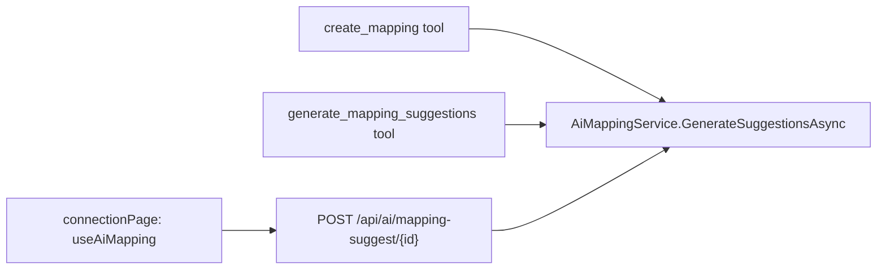
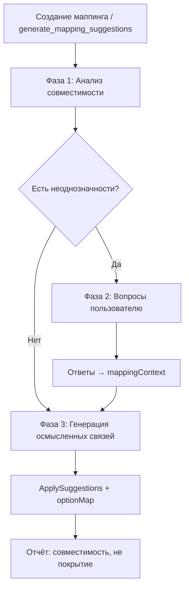

# Совместимость вместо покрытия: переработка AI-маппинга

> Переработка AI-флоу генерации маппинга: смена цели с «максимального покрытия полей» на «максимальную семантическую совместимость» локальной категории и категории адаптера, с фазой анализа неоднозначностей и вопросами пользователю перед применением связей.

**Goal:** Генерировать маппинги с акцентом на семантическую совместимость, а не на количество подключённых полей. Задавать пользователю вопросы про смысл данных перед применением неоднозначных связей.

**Architecture:** Трёхфазный пайплайн — анализ совместимости (`MappingCompatibilityService`) → вопросы пользователю → генерация только осмысленных связей (`AiMappingService`). Точки входа: UI при создании маппинга, `create_mapping`, `generate_mapping_suggestions`.

**Tech Stack:** .NET 8 / Vue 3 / существующий AI-стек (`AiMappingService`, `MappingIntelligenceService`, `GraphMutationService`)

---

## Философия

**Главная метрика успеха — не `connected/total`, а качество совместимости.**

Маппинг должен отражать реальную семантику данных: что локальный атрибут означает для бизнеса, что ожидает маркетплейс, и совпадают ли тип, единицы, словарь, направление синхронизации (import/export). Связь «поле есть — подключим что-нибудь» хуже, чем оставить поле пустым.

**Принципы:**
- Подключать только то, где есть обоснованная семантическая пара (локальный источник ↔ поле адаптера).
- Пропускать поля, где единственный «матч» — совпадение названия, но разный смысл (например, «Модель» локально = артикул производителя, на маркетплейсе = название линейки).
- Не выдумывать derived/static значения «на всякий случай» — только когда категория/контекст однозначно задаёт константу.
- Для cross-marketplace (схема импортирована с маркетплейса A → маппинг на B) — optionMap обязателен и полный, но только для **правильно** выбранной пары атрибут↔поле.
- Вопросы пользователю — про **смысл**, не про «подключить ещё 12 полей».

---

## Текущее состояние (что есть сейчас)

### Точки входа (все ведут в один пайплайн)



| Точка | Файл | Поведение |
|-------|------|-----------|
| UI при создании | `frontend/src/pages/marketplace/connectionPage.vue` | `skipAutoMapping` + фоновый `mapping-suggest` |
| API | `backend/Controllers/AiController.cs` | Батчи, operationId, SignalR |
| `create_mapping` | `backend/Services/Ai/Tools/Handlers/MappingToolHandlers.cs`:104 | Сразу `GenerateSuggestionsAsync` без вопросов |
| `generate_mapping_suggestions` | тот же handler:493 | `get_mapping` рекомендуется в промпте, но не обязателен |

### Пайплайн `AiMappingService.GenerateSuggestionsAsync`

1. Фильтр: только **неподключённые** поля адаптера.
2. Батчи по **15 полей** — каждый батч независимый LLM-вызов.
3. Контекст: атрибуты категории, 2 примера маппингов того же адаптера, `MappingIntelligenceService`:
   - `schemaContext` — откуда пришла схема (sibling mapping)
   - `productSample` — превью-товар
   - `optionAlignmentHints` — предрасчёт optionMap (score по имени)
4. Промпт: `AiPrompts.MappingSystem` + `MappingRules`.
5. Порог: `confidence ≥ 0.4` → `ApplySuggestionsAsync`.
6. Постобработка: `EnsureSelectValueMapsAsync`.

### Противоречие с целевой идеей (явно в промптах)

```csharp
// backend/Services/Ai/Prompts/AiPrompts.cs
public const string MappingSystem =
    "You are an expert at mapping product catalog fields to marketplace API fields. " +
    "Your primary goal is to configure the MAXIMUM number of fields correctly. " +
    ...
```

```
TASK: For each marketplace field, suggest the best source. Cover as many fields as possible.
Never skip a field just because it needs a modifier — add the modifier instead.
```

```
=== DERIVED VALUES — BE BOLD ===
... A derived suggestion with confidence 0.5-0.7 ... is MUCH more useful than a skipped field.
```

Система **оптимизирует покрытие**, а не совместимость. `analyze_mapping_quality` и coverage в `get_mapping` усиливают эту метрику.

### Что уже помогает совместимости (задел)

- `schemaContext.schemaSource` — cross-marketplace словари.
- `optionAlignmentHints` с `MatchScore` — но только по **имени** (exact/partial), без семантики.
- `get_mapping` / `get_option_alignment_hints` — чат может читать контекст, но **не задаёт вопросы** перед `generate_mapping_suggestions`.
- `merge_adapter_fields` — дубликаты на стороне адаптера (не локаль↔адаптер).
- Import/export consistency в `MappingRules` (п.12) — есть, но перекрывается «BE BOLD».

---

## Целевой флоу: три фазы



### Фаза 1 — Анализ совместимости (новый слой)

**Новый сервис** (рабочее имя): `MappingCompatibilityService` — детерминированный + один LLM-проход «обзор», не покадровый батч.

**Вход:** `CategoryMapping`, локальные атрибуты, `ExternalField[]`, `schemaContext`, `productSample`, sibling graphs (опционально).

**Выход:** `CompatibilityReport`:

| Блок | Содержание |
|------|------------|
| `clearMatches` | Пары с высокой уверенностью: sku↔article, name↔title, aspect color↔цвет и т.д. |
| `ambiguousPairs` | Несколько кандидатов на одно поле или одно поле локально ↔ несколько полей адаптера |
| `incompatible` | Тип/единица/словарь не сходятся без потери смысла |
| `adapterOnly` | Поля маркетплейса без разумного локального источника (оставить пустыми) |
| `localOnly` | Локальные атрибуты без поля на маркетплейсе (не форсировать) |
| `crossMarketplaceRisks` | Select с разными key-space + низкий label overlap |
| `requiredGaps` | Обязательные поля адаптера без clear match — кандидаты на вопрос |

**Критерии «имеет смысл» (scoring, не только LLM):**

1. **Семантика** — синонимы имён + группа атрибута + description/hint + тип поля.
2. **Типовая совместимость** — string↔string, number↔number; text→number только с явным модификатором и высоким score.
3. **Единицы** — mm/g/kg; multiply только если единица в имени атрибута согласована.
4. **Словари** — для Select: overlap labels ≥ порога; cross-marketplace — полнота optionMap; не маппить атрибут «Размер обуви EU» на поле «Размер одежды RU».
5. **Aspect/variation** — `isAspect=true` только на выделенные variation-атрибуты.
6. **Bidirectional safety** — truncate на price/sku/barcode → штраф или skip.
7. **Cardinality** — один локальный атрибут → максимум одно «основное» поле адаптера (кроме aliases).
8. **Константы** — static только при category-level очевидности (бренд магазина, страна по умолчанию).

**Пороги (предложение):**
- `≥ 0.85` — auto-connect в фазе 3
- `0.60–0.84` — вопрос или connect с пометкой «review»
- `< 0.60` — не подключать (даже required — сначала вопрос)

### Фаза 2 — Вопросы пользователю

**Когда задавать:**
- `ambiguousPairs` с близкими score (разница < 0.15)
- cross-marketplace: атрибут с options, но hint score < 80
- единицы: локально «Вес» без unit в имени, адаптер `unit:"g"`
- semantic collision: два адаптерных поля хотят один атрибут
- business meaning: «Производитель» vs «Бренд», «Состав» vs «Материал»
- required gap без clear match

**Формат вопроса (структурированный):**

```json
{
  "id": "q_weight_unit",
  "type": "unit_confirm | source_pick | dictionary_confirm | skip_field | constant_value",
  "adapterFieldKey": "weight",
  "candidates": [
    { "sourceType": "attribute", "sourceAttributeId": 12, "label": "Вес, кг", "score": 0.72 },
    { "sourceType": "attribute", "sourceAttributeId": 45, "label": "Масса брутто, г", "score": 0.68 }
  ],
  "question": "Какой атрибут соответствует полю «Вес» на маркетплейсе (ожидаются граммы)?",
  "defaultRecommendation": "attribute:45 + multiply(0.001) если источник в кг",
  "impact": "export_and_import"
}
```

**Правила UX:**
- Не более **3–5 вопросов** за сессию; остальное — «оставить пустым» по умолчанию.
- Один вопрос = одно семантическое решение (согласуется с `ChatSystem`: один clarifying question).
- Ответы сохраняются в `mapping.compatibilityContextJson` (новое поле) или в сессии операции — для повторного `generate_mapping_suggestions`.

**Где задавать вопросы:**

| Контекст | Механизм |
|----------|----------|
| **Чат** (`generate_mapping_suggestions`) | Ассистент вызывает `analyze_mapping_compatibility` → показывает вопросы в чате → после ответов `generate_mapping_suggestions` с `answers` |
| **UI создания** | Модалка/wizard после создания маппинга, до фонового job; или redirect в чат с презаполненным контекстом |
| **Повторный запуск** | Пропуск фазы 2, если `compatibilityContextJson` актуален |

### Фаза 3 — Генерация (переработанный `AiMappingService`)

**Изменения алгоритма:**

1. **Не батчить все поля подряд** — сначала `clearMatches` (детерминированно или малый LLM), потом только `ambiguous` + `requiredGaps` с учётом ответов.
2. **Жёсткий skip** — поля без пары в отчёте не попадают в промпт (сейчас все unconnected идут в батч).
3. **Новый system prompt** — цель: «maximum semantic compatibility», explicit skip list.
4. **Повысить порог confidence** — с 0.4 до **0.65** для auto-apply; 0.5–0.65 только с user answer.
5. **Убрать/смягчить «BE BOLD»** — derived values только для явно одобренных паттернов (oldPrice из price — да, если пользователь подтвердил стратегию цен).
6. **Inject user answers** в user prompt как `=== USER SEMANTIC DECISIONS ===`.
7. **Отчёт результата** — `compatibilityScore`, `connectedWithHighConfidence`, `leftIntentionallyEmpty`, `needsReview` вместо акцента на `skipped`.

---

## Изменения по точкам входа

### 1. UI: создание маппинга (`connectionPage.vue`)

**Сейчас:** create → сразу `mapping-suggest` в фоне.

**Целевое:**
1. Create mapping (пустой граф, как сейчас при `useAiMapping`).
2. `POST /api/ai/mapping-analyze/{id}` → `CompatibilityReport`.
3. Если `questions.length > 0` — показать **MappingCompatibilityWizard** (новый компонент).
4. `POST /api/ai/mapping-suggest/{id}` с `{ operationId, answers, mode: "compatibility" }`.
5. Progress в operations panel — шаги: «Анализ» → «Генерация N связей» (не «батч 3/7 по 15 полей»).

Чекбокс «Использовать AI» → переименовать смысл: «Умный маппинг с проверкой совместимости».

### 2. Чат: `create_mapping`

**Сейчас:** создаёт и сразу генерирует.

**Целевое:**
1. `create_mapping` только создаёт запись (или флаг `skipAutoGenerate: true`).
2. Ассистент: `analyze_mapping_compatibility` → вопросы → `propose_plan` с шагом `generate_mapping_suggestions`.
3. Обновить описание tool в `AiChatService` и `AiPrompts.ChatSystem`.

### 3. Чат: `generate_mapping_suggestions`

**Сейчас:** сразу полный прогон всех unconnected.

**Целевое workflow (в ChatSystem):**

```
get_mapping(id, productId?) 
  → analyze_mapping_compatibility(id) 
  → [если questions] спросить пользователя 
  → generate_mapping_suggestions(id, productId?, answers?)
```

Tool schema расширить: опциональный `answers: Record<string, string | number>`.

**Важно:** tool остаётся mutating → по-прежнему через `propose_plan` в чате, но план должен включать фазу вопросов **до** мутации.

---

## Новые API и tools

| Имя | Тип | Назначение |
|-----|-----|------------|
| `analyze_mapping_compatibility` | tool + `GET/POST .../mapping-analyze/{id}` | Фаза 1, возвращает report + questions |
| `submit_mapping_compatibility_answers` | tool (опционально) | Сохранить ответы без генерации |
| `generate_mapping_suggestions` | расширить | Принимает `answers`, `mode` |
| `mapping.compatibilityContextJson` | DB column | Кэш ответов и версия схемы |

---

## Изменения промптов

### `MappingSystem` (замена)

- Primary goal: **configure semantically correct mappings** between local catalog and marketplace category.
- **Prefer leaving a field unconnected** over a plausible-but-wrong connection.
- Only connect when source and target share business meaning, compatible type, and reversible or acceptable transform.
- Required fields: suggest best effort **only after** user context or clear match ≥ 0.85.

### `MappingRules` (замена акцентов)

- Удалить: «Cover as many fields as possible», «BE BOLD», «confidence ≥ 0.4 for required».
- Добавить: **Skip decision tree** — когда `sourceType: null` обязателен.
- Добавить: **One source — one primary target** (кроме merge_adapter_fields).
- Сохранить: cross-marketplace optionMap, units, truncate rules, import/export consistency.
- Derived values: whitelist (oldPrice, template short desc) + только с `userApproved: true` в контексте.

### `ChatSystem` (дополнение)

- Перед `generate_mapping_suggestions` **всегда** `analyze_mapping_compatibility`.
- Вопросы про смысл полей, не про «хотите подключить ещё».
- Не хвалить высокий coverage — сообщать `highConfidenceConnections` и `intentionallySkipped`.

---

## Примеры вопросов (таксономия)

| Тип | Пример |
|-----|--------|
| `source_pick` | «Поле „Цвет“ — это атрибут „Цвет товара“ (id=8) или „Оттенок“ (id=19)?» |
| `dictionary_confirm` | «Словарь цветов импортирован с Ozon. Подтвердите: „Бордовый“ → „бордовый“ на WB?» |
| `unit_confirm` | «„Длина“ в см, маркетплейс ждёт мм — умножать на 10?» |
| `semantic_confirm` | «„Модель“ у вас = SKU производителя; на маркетплейсе „Модель“ = название линейки. Пропустить или взять из названия товара?» |
| `constant_value` | «Поле „Страна производства“ — всегда „Россия“ для этой категории?» |
| `skip_field` | «Поле „НДС“ не имеет локального источника. Оставить пустым?» |
| `price_strategy` | «Старая цена: считать как price×1.3 или брать из атрибута „Цена до скидки“?» |

---

## Метрики и отчёты (смена KPI)

**Было:** `connected`, `skipped`, `coverage %`

**Стало:**

```typescript
{
  highConfidenceConnected: number,
  reviewNeeded: number,
  intentionallySkipped: number,
  requiredCovered: number,
  requiredTotal: number,
  compatibilityScore: number,  // 0-1, взвешенный по required + aspects
  questionsAsked: number,
  questionsAnswered: number
}
```

`analyze_mapping_quality` — добавить режим «semantic quality», не только coverage.

---

## План реализации

Рекомендуемый порядок PR-ов:

### PR1 — Совместимость без UI (backend core)
- `MappingCompatibilityService` + DTO
- `analyze_mapping_compatibility` tool + endpoint
- Unit-тесты на scoring (имена, units, option overlap)

### PR2 — Промпты и генерация
- Новые `MappingSystem` / `MappingRules`
- `GenerateSuggestionsAsync` принимает `CompatibilityReport` + `answers`
- Порог confidence, skip list, убрать blind batching

### PR3 — Чат-флоу
- Обновить `ChatSystem`, tool descriptions, workflow в `AiChatService`
- `generate_mapping_suggestions` + `answers`
- `create_mapping` без auto-generate по умолчанию

### PR4 — UI wizard
- `MappingCompatibilityWizard.vue`
- Интеграция в `connectionPage` + `fieldMappingPage` (кнопка «Пересобрать с вопросами»)
- `compatibilityContextJson` migration

### PR5 — Полировка
- Отчёты operations panel
- Rollback совместим с новым flow
- Документация `docs/architecture/ai-assistant.md`

---

## Риски и решения

| Риск | Решение |
|------|---------|
| Меньше auto-connected полей — пользователь недоволен coverage | Явный отчёт «пропущено намеренно» + кнопка «подключить агрессивно» (legacy mode) |
| Долгий wizard при создании | Лимит вопросов + smart defaults из report |
| Чат не ждёт ответов | Жёсткое правило в ChatSystem: no `generate_mapping_suggestions` while `questions.pending` |
| Дублирование логики hint vs compatibility | `BuildAlignmentHintsAsync` становится подмодулем compatibility scoring |

---

## Ключевые файлы для правок

- `backend/Services/Ai/AiMappingService.cs` — фаза 3
- `backend/Services/Ai/MappingIntelligenceService.cs` — расширить / вынести scoring
- **Новый:** `backend/Services/Ai/MappingCompatibilityService.cs`
- `backend/Services/Ai/Prompts/AiPrompts.cs` — промпты
- `backend/Services/Ai/Tools/Handlers/MappingToolHandlers.cs` — tools
- `backend/Controllers/AiController.cs` — endpoints
- `frontend/src/pages/marketplace/connectionPage.vue` — wizard hook

---

## Todos

- [ ] **compatibility-service** — PR1: MappingCompatibilityService — scoring, CompatibilityReport, analyze_mapping_compatibility tool/endpoint
- [ ] **prompts-generation** — PR2: Переписать MappingSystem/MappingRules; GenerateSuggestionsAsync с report+answers, skip list, порог 0.65
- [ ] **chat-workflow** — PR3: ChatSystem workflow analyze→questions→generate; create_mapping без auto-gen; answers в generate_mapping_suggestions
- [ ] **ui-wizard** — PR4: MappingCompatibilityWizard + connectionPage/fieldMappingPage; compatibilityContextJson migration
- [ ] **metrics-docs** — PR5: Новые метрики отчёта, legacy aggressive mode, обновить ai-assistant.md